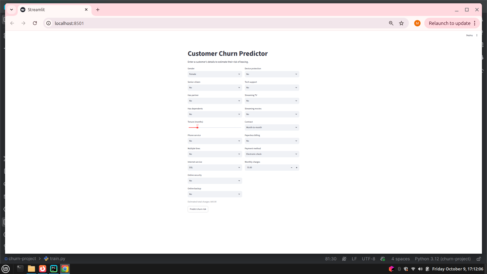
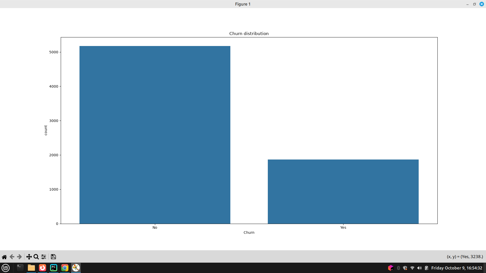
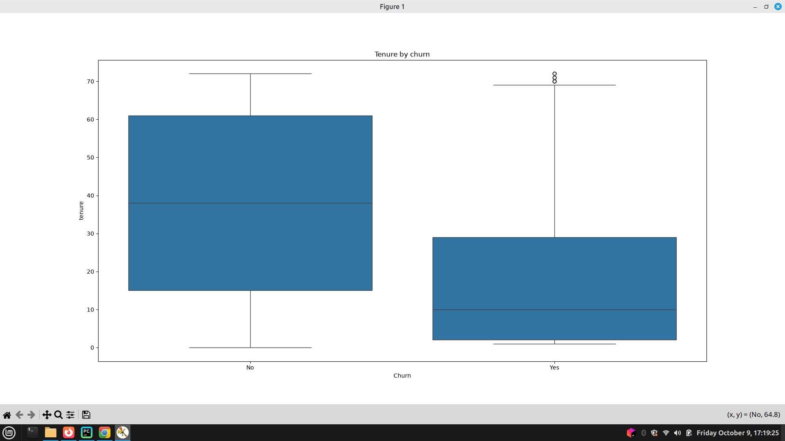
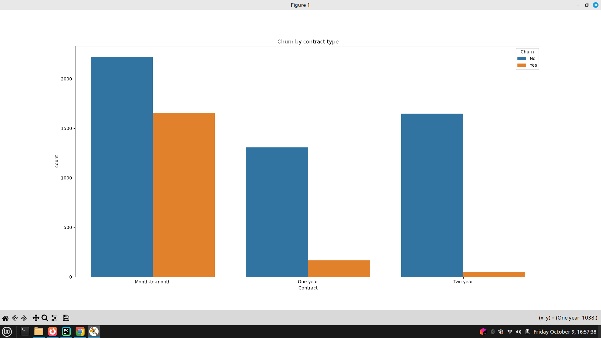
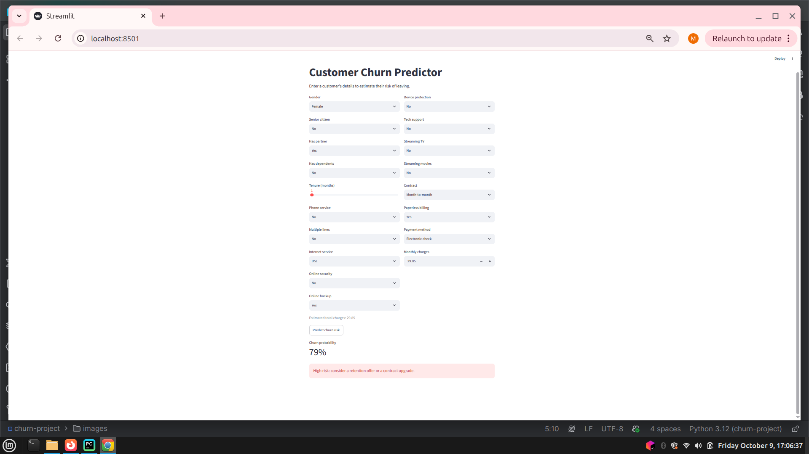
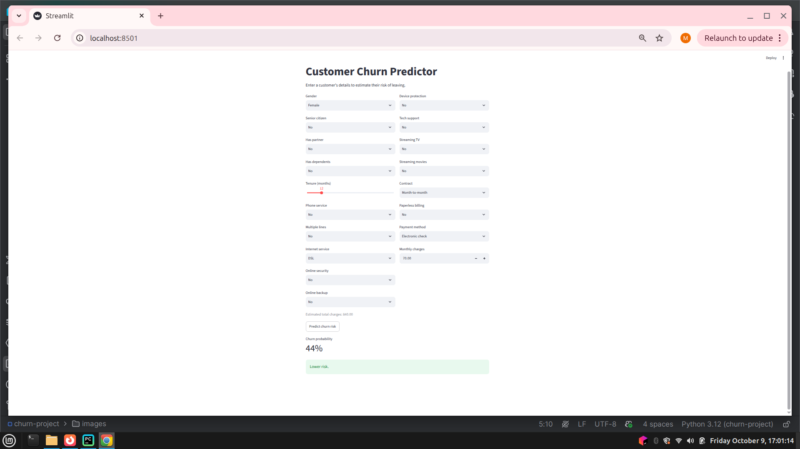

# Customer Churn Prediction

A machine learning project that predicts which telecom customers are likely to leave, ranks them by risk, and shows which factors drive churn. Includes a Streamlit web app for scoring individual customers.

**Live demo:** `<add your Streamlit link here, or delete this line>`

<!-- IMAGE 1: main app screenshot (the full form with a prediction shown). Save as images/app.png -->


## Summary

- Trained on 7,043 telecom customers; **26.5% churned**.
- On 1,409 unseen customers, the model **caught 78% of the customers who left** (recall 0.78, ROC AUC 0.84).
- Among the **100 customers ranked riskiest, 73% actually churned**, versus 27% overall, so outreach guided by the model reaches about 2.7 times as many real churners as random outreach.
- The biggest churn signals are **a short tenure** and **a month-to-month contract**.

---

## Table of contents

1. [Business problem](#business-problem)
2. [Dataset](#dataset)
3. [Key findings from exploration](#key-findings-from-exploration)
4. [Approach](#approach)
5. [Results](#results-test-set-1409-unseen-customers)
6. [What drives churn](#what-drives-churn)
7. [The app](#the-app)
8. [Limitations](#limitations)
9. [Possible next steps](#possible-next-steps)
10. [Project structure](#project-structure)
11. [How to run](#how-to-run)

---

## Business problem

Keeping an existing customer costs less than winning a new one. If a company can identify at-risk customers early, it can target retention offers where they matter most. This project answers two questions:

1. **Who is likely to leave?** A risk score for every customer.
2. **Why?** The factors most associated with leaving, so the business knows where to act.

## Dataset

[Telco Customer Churn](https://www.kaggle.com/datasets/blastchar/telco-customer-churn) (Kaggle).

- 7,043 customers and 21 columns (contract, tenure, services, billing, and the `Churn` outcome)
- **26.5% of customers churned**, so the data is imbalanced (5,174 stayed, 1,869 left)
- No duplicate rows; no true missing values, but 11 hidden blanks in `TotalCharges` (see [Approach](#approach))

## Key findings from exploration

**The data is imbalanced.** About 3 customers stay for every 1 who leaves. A model that predicted "nobody leaves" would score 73% accuracy while catching zero churners, which is why accuracy alone is not used to judge the models.

<!-- IMAGE 2: the "Churn distribution" chart from explore.py. Save as images/churn_distribution.png -->


**Churn falls sharply as tenure grows:**

| Tenure | Churn rate |
|---|---|
| 0-12 months | 47% |
| 13-24 months | 29% |
| 25-48 months | 20% |
| 49-72 months | 9.5% |

<!-- IMAGE 3: the "Tenure by churn" box plot. Save as images/tenure_by_churn.png -->


Customers who leave typically do so early: the median tenure of churners is about 10 months, versus about 38 months for customers who stayed.

**Contract type matters a lot.** Month-to-month customers churn at roughly 43%, versus roughly 11% for one-year and 3% for two-year contracts. Nearly all churn comes from month-to-month customers.

<!-- IMAGE 4: the "Churn by contract type" chart. Save as images/churn_by_contract.png -->


## Approach

1. **Explore** (`explore.py`): checked size, types, missing values, duplicates, and class balance.
2. **Clean** (`clean.py`):
   - Dropped `customerID` (a unique label, not a signal).
   - Found that `TotalCharges` was stored as text, with 11 blank entries. All 11 belong to customers with `tenure = 0` (new, not yet billed), so they were filled with `0`, the true amount paid, instead of an average.
   - Converted the target to 1 (churned) and 0 (stayed).
3. **Prepare features** (`train.py`): scaled the numeric columns (`StandardScaler`) and one-hot encoded the 15 categorical columns, expanding 19 inputs into 45 features.
4. **Split**: 80% training and 20% test (1,409 customers), stratified so both sets keep the 26.5% churn rate. The test set was never used for training or preprocessing.
5. **Avoid data leakage**: preprocessing and model are combined in a scikit-learn `Pipeline`, so the scaler and encoder learn only from training data.
6. **Train and compare** three models: a do-nothing baseline, logistic regression, and a random forest. Both real models use `class_weight="balanced"` to handle the imbalance.
7. **Evaluate** on the unseen test set using precision, recall, F1, and ROC AUC, not accuracy alone.
8. **Save** the chosen pipeline with `joblib` and serve it through a Streamlit app (`app.py`).

## Results (test set, 1,409 unseen customers)

| Model | Accuracy | Churn recall | Churn precision | Churn F1 | ROC AUC |
|---|---|---|---|---|---|
| Baseline (always "stay") | 0.73 | 0.00 | 0.00 | 0.00 | 0.50 |
| **Logistic regression** (chosen) | 0.74 | 0.78 | 0.50 | 0.61 | 0.842 |
| Random forest | 0.76 | 0.78 | 0.53 | 0.63 | 0.841 |

**Why not accuracy?** The do-nothing baseline scores 73% accuracy while catching zero churners. Recall on the churn class reflects the business goal: finding the customers who are about to leave.

**Confusion matrix (logistic regression):**

| | Predicted stay | Predicted churn |
|---|---|---|
| **Actually stayed** | 747 | 288 (false alarms) |
| **Actually churned** | 81 (missed) | 293 (caught) |

- **Recall 0.78:** the model caught 293 of the 374 customers who actually left.
- **Precision 0.50:** of the 581 customers it flagged, 293 really left.

**Why logistic regression?** The random forest scored only slightly higher (F1 0.63 vs 0.61), a gap small enough to be noise on a single test split. With near-identical performance, the simpler model wins because its reasoning can be explained to a client.

**The trade-off:** `class_weight="balanced"` raised recall from 0 to 0.78 at the cost of more false alarms (precision 0.50). Whether that is the right balance depends on the cost of a retention offer versus the cost of losing a customer. The 0.5 decision cutoff can be adjusted accordingly.

### Ranking quality

Scoring all 1,409 test customers and sorting by risk:

| Group | Actual churn rate |
|---|---|
| 100 customers ranked riskiest | **73%** |
| All test customers | 27% |

A retention team working from the top of the list reaches about 2.7 times as many real churners as random outreach. The full ranked list is saved in `data/test_predictions.csv`.


## What drives churn

Logistic regression weights (positive pushes toward leaving, negative toward staying; numeric features were scaled):

| Factor | Weight | Reading |
|---|---|---|
| Tenure | -1.15 | Longer-staying customers are much less likely to leave |
| Two-year contract | -0.78 | Strongly reduces risk |
| DSL internet | -0.63 | Lower risk than fiber |
| Fiber optic internet | +0.71 | Higher risk |
| Month-to-month contract | +0.66 | Higher risk |
| Streaming movies / TV | +0.28 / +0.26 | Mild increase (likely tied to higher bills) |
| Electronic check payment | +0.24 | Mild increase |
| No online security / no tech support | +0.20 / +0.16 | Mild increase |

**Business takeaways**

1. **The first year is the danger zone.** Nearly half of new customers leave, so onboarding and early retention offers have the highest impact.
2. **Contracts retain customers.** Converting month-to-month customers to longer contracts is the clearest lever.
3. **Fiber customers churn more than DSL customers.** Worth investigating (price, reliability, competition).
4. **Add-on services may help.** Customers without tech support or online security are slightly higher risk.

## The app

`app.py` is a Streamlit form: enter a customer's details and get a churn risk score.

- The saved pipeline handles all scaling and encoding, so the app passes raw inputs straight to the model.
- `TotalCharges` is estimated as `tenure x monthly charges`, since a user will not know a lifetime total.
- Because the model uses class weighting, its probabilities run higher than real-world rates. **Treat the score as a relative risk ranking, not a literal percentage.**

**Example: a high-risk customer** (1 month tenure, month-to-month, fiber optic, electronic check, no support or security add-ons):

<!-- IMAGE 5: app screenshot showing the high-risk result. Save as images/app_high_risk.png -->


**Example: a low-risk customer** (60 months tenure, two-year contract, DSL, automatic payment, add-ons included):

<!-- IMAGE 6: app screenshot showing the low-risk result. Save as images/app_low_risk.png -->


## Limitations

- **One dataset, one company.** The model should be retrained on a client's own customers before use.
- **Association, not causation.** The weights show what goes with leaving, not what would change behavior. Testing retention offers would be needed to prove impact.
- **Overlapping features.** `tenure`, `MonthlyCharges`, and `TotalCharges` are correlated, so individual weights (for example the negative `MonthlyCharges` weight) should be read as an overall pattern, not in isolation.
- **Single test split.** Small differences between models could be noise; cross-validation would give a more stable comparison.
- **Probabilities are not calibrated** (see [The app](#the-app)).
- **No hyperparameter tuning.** Settings were chosen sensibly, not optimized.

## Possible next steps

- Cross-validation and hyperparameter tuning
- Probability calibration and an adjustable decision threshold in the app
- A cost-benefit analysis to pick the best cutoff
- Persisting prediction history in a database

## Project structure

```
churn-project/
├── data/
│   ├── WA_Fn-UseC_-Telco-Customer-Churn.csv   # raw data
│   ├── clean.csv                              # output of clean.py
│   └── test_predictions.csv                   # ranked risk list (test set)
├── images/                                    # screenshots used in this README
├── explore.py       # data exploration and charts
├── clean.py         # cleaning, saves clean.csv
├── train.py         # preprocessing, training, evaluation, saves model.joblib
├── test_model.py    # spot checks, saves test_predictions.csv
├── app.py           # Streamlit app
├── model.joblib     # trained pipeline (logistic regression)
├── requirements.txt
└── README.md
```

## How to run

```bash
# 1. Clone and enter the project
git clone https://github.com/ibrahim-640<your-username>/churn-prediction.git
cd churn-prediction

# 2. Create and activate a virtual environment
python3 -m venv venv
source venv/bin/activate        # Windows: venv\Scripts\activate

# 3. Install dependencies
pip install -r requirements.txt

# 4. Reproduce the pipeline (optional; model.joblib is included)
python clean.py
python train.py
python test_model.py

# 5. Launch the app
streamlit run app.py
```

`model.joblib` must be loaded with the same scikit-learn version it was created with, which is why versions are pinned in `requirements.txt`.

## Tech stack

Python 3.12 · pandas · NumPy · scikit-learn · matplotlib · seaborn · joblib · Streamlit

## Author

`<Ibrahim Mutisia>` 
